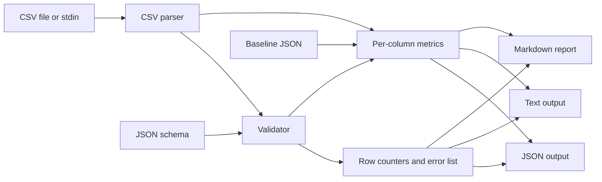

# Data Quality Monitor

A stream-friendly command-line tool that validates CSV files against an explicit
JSON schema, computes per-column quality metrics (null rates, IQR outliers,
distribution statistics), compares them with a baseline, and renders Markdown
reports — with stable JSON output for automation.



## Install

Requires Python 3.9+ (developed and tested on Python 3.12). No third-party
runtime dependencies — the standard library is enough.

```bash
git clone https://github.com/forgeline-labs/data-quality-monitor.git
cd data-quality-monitor
./app --version
# data-quality-monitor 0.1.0
```

The `app` entry point is a POSIX executable Python script; run `chmod +x app`
if your clone lost the executable bit.

## Usage

```text
./app <subcommand> [options] [FILE]
```

`FILE` is optional. When it is missing or `-`, the CSV is read from stdin.
Flags may appear before or after `FILE`, and accept both `--flag value` and
`--flag=value`.

### `validate`

Validates every data row against the schema and lists per-cell errors.

```bash
./app validate --schema tests/fixtures/ac1_schema.json --json tests/fixtures/ac1.csv
```

Real output:

```json
{"version":"0.1","command":"validate","input":{"source":"file","path":"tests/fixtures/ac1.csv","format":"csv","lines_total":3,"lines_valid":3,"lines_invalid":0},"errors":[]}
```

Text mode (the default when `--json` is absent):

```bash
./app validate --schema tests/fixtures/ac1_schema.json tests/fixtures/ac1.csv
```

```text
total_lines: 3
valid_lines: 3
invalid_lines: 0

errors: none
```

### `analyze`

Computes per-column metrics. `--outlier-threshold K` sets the IQR multiplier
(default `1.5`); `--baseline PATH` adds a comparison block.

```bash
./app analyze --schema tests/fixtures/ac1_schema.json tests/fixtures/ac1.csv
```

```text
format: csv
lines_total: 3
lines_valid: 3
lines_invalid: 0

column: user_id
  type: integer
  count: 3
  null_rate: 0.00%
  distinct_count: 3
  min: 1.00
  max: 3.00
  mean: 2.00
  stddev: 0.82
  q1: 1.50
  q2: 2.00
  q3: 2.50
  iqr: 1.00
  outlier_count: 0

column: email
  type: string
  count: 3
  null_rate: 0.00%
  distinct_count: 3

column: age
  type: integer
  count: 2
  null_rate: 33.33%
  distinct_count: 2
  min: 25.00
  max: 30.00
  mean: 27.50
  stddev: 2.50
  q1: 26.25
  q2: 27.50
  q3: 28.75
  iqr: 2.50
  outlier_count: 0
```

JSON mode with a baseline:

```bash
./app analyze --schema tests/fixtures/ac1_schema.json \
  --baseline tests/fixtures/ac1_baseline.json --json tests/fixtures/ac1.csv
```

```json
{"version":"0.1","command":"analyze","input":{"source":"file","path":"tests/fixtures/ac1.csv","format":"csv","lines_total":3,"lines_valid":3,"lines_invalid":0},"outlier_threshold":1.5,"columns":[{"name":"user_id","type":"integer","count":3,"null_rate":0.0,"distinct_count":3,"min":1.0,"max":3.0,"mean":2.0,"stddev":0.816497,"q1":1.5,"q2":2.0,"q3":2.5,"iqr":1.0,"outlier_count":0,"baseline_comparison":{"expected_null_rate":0.0,"actual_null_rate":0.0,"diff_null_rate":0.0,"expected_outlier_count":0.0,"actual_outlier_count":0,"diff_outlier_count":0.0}},{"name":"email","type":"string","count":3,"null_rate":0.0,"distinct_count":3,"baseline_comparison":{"expected_null_rate":10.0,"actual_null_rate":0.0,"diff_null_rate":-10.0,"expected_outlier_count":null,"actual_outlier_count":null,"diff_outlier_count":null}},{"name":"age","type":"integer","count":2,"null_rate":33.333333,"distinct_count":2,"min":25.0,"max":30.0,"mean":27.5,"stddev":2.5,"q1":26.25,"q2":27.5,"q3":28.75,"iqr":2.5,"outlier_count":0,"baseline_comparison":{"expected_null_rate":0.0,"actual_null_rate":33.333333,"diff_null_rate":33.333333,"expected_outlier_count":null,"actual_outlier_count":0,"diff_outlier_count":null}}],"baseline_path":"tests/fixtures/ac1_baseline.json"}
```

### `report`

Writes a Markdown report. `--out` is required; `--out -` writes the complete
Markdown to stdout without creating a file. `--json` is rejected with `report`.

```bash
./app report --schema tests/fixtures/ac1_schema.json \
  --out report.md --now 2026-10-06T12:00:00Z tests/fixtures/ac1.csv
```

Real report body (`--baseline tests/fixtures/ac1_baseline.json` added here to
show the comparison table):

```markdown
# Data Quality Report

- Input: `tests/fixtures/ac1.csv`
- Schema: `tests/fixtures/ac1_schema.json`
- Generated at: `2026-10-06T12:00:00Z`
- Lines: `3 valid, 0 invalid`

## Validation Summary
- **Total rows:** 3
- **Valid rows:** 3
- **Invalid rows:** 0

## Column Analysis

### user_id (integer)
- **Count:** 3
- **Null rate:** 0.00%
- **Distinct values:** 3
- **Sample values:** `1`, `2`, `3`
- **Min:** 1.00, **Max:** 3.00, **Mean:** 2.00
- **Q1:** 1.50, **Median:** 2.00, **Q3:** 2.50
- **IQR:** 1.00
- **Outliers detected:** 0

### email (string)
- **Count:** 3
- **Null rate:** 0.00%
- **Distinct values:** 3
- **Sample values:** `alice@example.com`, `bob@example.com`, `charlie@example.com`

### age (integer)
- **Count:** 2
- **Null rate:** 33.33%
- **Distinct values:** 2
- **Sample values:** `30`, `25`
- **Min:** 25.00, **Max:** 30.00, **Mean:** 27.50
- **Q1:** 26.25, **Median:** 27.50, **Q3:** 28.75
- **IQR:** 2.50
- **Outliers detected:** 0

## Baseline Comparison

| Column | Expected Null Rate | Actual Null Rate | Difference |
|---|---|---|---|
| user_id | 0.00% | 0.00% | 0.00% |
| email | 10.00% | 0.00% | -10.00% |
| age | 0.00% | 33.33% | 33.33% |
```

### Global flags

| Flag | Values | Default | Effect |
|---|---|---|---|
| `--schema PATH` | path | required | JSON schema file |
| `--format FMT` | `csv` | `csv` | input format (`csv` only in v0.1) |
| `--json` | — | off | compact single-line JSON on stdout |
| `--quiet` | — | off | suppress stderr warnings |
| `--help` | — | — | print help, exit 0 |
| `--version` | — | — | print `data-quality-monitor 0.1.0`, exit 0 |

`validate` also accepts `--strict` (exit `3` when any row is invalid).
`analyze` and `report` accept `--baseline` and `--outlier-threshold`.
`report` additionally accepts `--out` and `--now`.

## Schema format

The schema is a JSON object with a `columns` array. Every column requires a
`name` and a `type`; `required`, `nullable`, `pattern`, `min` and `max` are
optional.

```json
{
  "columns": [
    {"name": "user_id", "type": "integer", "required": true, "nullable": false},
    {"name": "email", "type": "string", "required": true, "nullable": false,
     "pattern": "^[^@]+@[^@]+$"},
    {"name": "age", "type": "integer", "required": false, "nullable": true,
     "min": 0, "max": 150},
    {"name": "score", "type": "float", "required": false, "nullable": true},
    {"name": "active", "type": "boolean", "required": false, "nullable": true},
    {"name": "signup", "type": "date", "required": false, "nullable": true}
  ]
}
```

Supported types:

| Type | Accepted values |
|---|---|
| `string` | any non-null text |
| `integer` | optional sign followed by digits (`-12`, `+7`, `42`) |
| `float` | decimal or scientific notation (`1`, `-2.5`, `1e3`) |
| `boolean` | `true` or `false` (case-insensitive) |
| `date` | ISO-8601 calendar date (`2026-10-06`) |

Validation rules:

- If a schema column is missing from the CSV header, every row treats it as
  `null`.
- Columns present in the CSV but absent from the schema are ignored and never
  invalidate a row.
- `required: true` and a null value ⇒ invalid row (`required field is null`).
- `nullable: false` and a null value ⇒ invalid row (`null value not allowed`).
- `pattern` is applied with regex search semantics to string values; a failed
  match invalidates the row.
- `min`/`max` apply to `integer` and `float` values.
- A row is valid when every schema column passes; multiple errors may be
  reported for a single row.

## Quality metrics

All metrics are computed per schema column.

- **Count:** number of non-null values.
- **Null rate:** `null_count / lines_total * 100`, as a percentage from `0.0`
  to `100.0`.
- **Distinct count:** number of unique non-null values.
- **Min / max:** smallest and largest numeric value.
- **Mean:** arithmetic mean.
- **Stddev:** population standard deviation (divides by `n`).
- **Quartiles:** `q1` and `q3` use nearest-rank over sorted values:
  `rank = min(n, max(1, ceil(p * (n + 1))))`, then select `sorted[rank - 1]`.
  `q2` is the median (average of the middle pair for even samples).
  For `[1, 2, 3]`, `q1 = 1`, `q2 = 2`, `q3 = 3`.
- **IQR:** `q3 - q1`.
- **Outliers:** a value is an outlier when
  `value < q1 - k * iqr` or `value > q3 + k * iqr`, where `k` is
  `--outlier-threshold` (default `1.5`). If `iqr == 0`, no value is ever an
  outlier, even with `k = 0`.

Numbers are serialised with half-up rounding: 6 decimal places in JSON, 2
decimal places in text output.

## CSV input

```csv
user_id,email,age
1,alice@example.com,30
2,bob@example.com,25
3,charlie@example.com,
```

Parsing rules:

- The first non-blank line is the header; it must contain at least one column.
- Delimiter is `,`. Fields containing commas, quotes or newlines must be
  quoted with `"`, and `""` inside a quoted field is a literal `"`.
- Unquoted values are trimmed; quoted values are preserved as written.
- Empty values and the literals `NA`, `N/A`, `null` and `NULL`
  (case-insensitive) become null.
- Blank lines (only whitespace) are ignored and counted nowhere.
- Rows with extra fields have the extras ignored; missing fields become null.
- Malformed rows never abort the process: they are counted in
  `lines_invalid` and reported. In text mode a warning is written to stderr
  unless `--quiet` is used.
- UTF-8 input, including CRLF line endings.

## Baseline format

A baseline is optional JSON with expected metrics per column. Both a mapping
and a list keyed by `name` are accepted.

```json
{
  "columns": {
    "user_id": {"expected_null_rate": 0.0, "expected_outlier_count": 0},
    "email": {"expected_null_rate": 10.0},
    "age": {"expected_null_rate": 0.0}
  }
}
```

The same document may also be written as
`{"columns": [{"name": "user_id", "expected_null_rate": 0.0}]}`. For each
column present in the baseline, `analyze` emits:

```json
{
  "expected_null_rate": 0.0,
  "actual_null_rate": 33.333333,
  "diff_null_rate": 33.333333,
  "expected_outlier_count": null,
  "actual_outlier_count": 0,
  "diff_outlier_count": null
}
```

A missing expected metric (or a metric that does not apply to the column type)
becomes `null`. Columns absent from the baseline get
`"baseline_comparison": null`.

## Exit codes

| Code | Condition |
|---|---|
| `0` | Success (empty input and mixed valid/invalid rows included) |
| `1` | Usage error: unknown command/flag, invalid value, missing required flag, `--json` with `report` |
| `2` | I/O error: unreadable input, unwritable `--out`, missing/invalid schema or baseline |
| `3` | Validation failed: at least one invalid row with `--strict`, or every non-empty data row invalid |
| `4` | Unexpected internal error (message on stderr) |

Error messages go to stderr; data goes to stdout. Empty input (0 bytes or only
whitespace) yields `lines_total = 0` and exit `0`.

## How this was built

This project was built spec-first. `SPEC.md` was written before any code and
served as the contract: CLI surface, JSON shapes, CSV parsing rules, metric
definitions, exit codes and worked examples.

The implementation was produced by an autonomous AI coding agent running in an
internal harness, with no human edits to the code. The black-box acceptance
tests that grade the deliverable were written by a **different, independent AI
agent** from the specification alone; they live outside this repository and
are run by the harness. The tests in `tests/blackbox/` here are the
implementation's own public acceptance tests, written in the same black-box
style (they only invoke `./app` as a subprocess).

The spec was treated as a set of testable examples rather than prose. That paid
off in two places during the first round:

- The metric section described quartiles as "nearest-rank" with a `ceil`
  index formula, but the fully worked JSON example and the small-`n` examples
  only agree with linear interpolation (`h = p * (n - 1)`). The first
  implementation followed the prose formula and contradicted the example
  (`q1 = 1` instead of `1.5` for `[1, 2, 3]`); the worked examples won, and
  the code now interpolates. The same inconsistency appears in AC-2, where
  `q3` is written as `8.25` although the spec's own interpolation rule gives
  `7.75` for ten values `[1..9, 100]`; the implementation follows the rule
  that all the other examples use.
- An early CSV reader reused Python's `csv` module directly, which loses the
  information needed to trim only unquoted fields and made row numbering wrong
  for quoted embedded newlines. A small record splitter plus field parser
  replaced it, and the quoted-field tests (`hello, world`,
  `quote "inside"`) now pass with the physical line numbers preserved.

Black-box tests earned their name here: they caught both classes of problem
because they assert observable output — exact JSON values, exit codes and
Markdown escaping — rather than internal helper calls.

## Testing

The acceptance tests are black-box: they invoke `./app` through
`subprocess.run` and never import `src/dqm`. Run them with:

```bash
make test
```

Other useful targets:

```bash
make lint    # ruff check + ruff format --check
make fmt     # apply ruff formatting and safe fixes
make smoke   # validate the AC-1 fixture and assert the JSON counters
```

The deterministic report test passes `--now`, so no test depends on the system
clock. Tests capture stdout/stderr through pipes, so ANSI colour is never
emitted.

## License

MIT © 2026 Gabriel Pinheiro — see [LICENSE](LICENSE).
